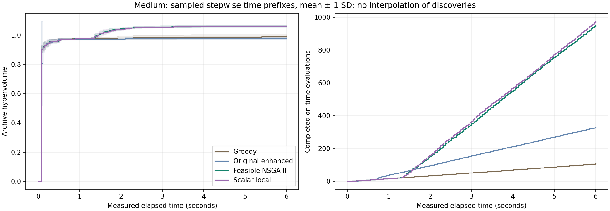
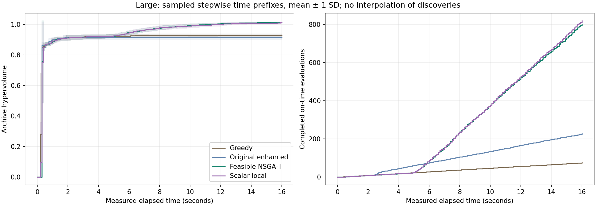

# Enhancing the timetable optimizer: held-out follow-up study

This report uses saved synthetic measurements. Historical benchmark records remain unchanged. The follow-up changes search operators and selection policies, while preserving the original generator, constraints, objectives, normalization, hypervolume reference and greedy scheduling policy.

All objectives are minimized: student internal teaching gaps plus half faculty gaps (excluding lunch); duration-weighted unused room-seat fraction; and population SD of faculty teaching load divided by weekly allowance. Hard constraints are never traded against these quality measures.

## What changed and why

Over 90% of the original enhanced method's raw offspring required repair. The new method seeds the full population feasibly and replaces destructive categorical crossover with resource-checked mutation. It genuinely retains NSGA-II rank/crowding tournaments and elitist parent–offspring survival; it is explicitly a mutation-only memetic NSGA-II variant.

Five neighborhoods move sessions, improve room assignments, swap events, jointly reinsert an offering under a new teacher, or exchange teachers of two offerings. A bounded deterministic branch-and-bound step reassigns up to eight whole offerings at fixed times/rooms. With common weekly allowances, minimizing the squared load sum minimizes true workload SD. Node limits prevent an unbounded local solve; no global optimality guarantee is implied. Faculty compactness can worsen, so every feasible proposal is evaluated on all three original objectives.

The scalar-local ablation receives the same initial constructive population and proposal family. It uses independent fixed positive scalar directions instead of the NSGA-II selection/survival bundle. This tests the bundle, not a single causal component. Later parent states and candidate streams diverge.

## Development and frozen validation

Development used previously declared seeds 9000+. A twelve-run pilot at 240 full evaluations covered one instance/solver seed (9000) at each size and four methods. Those exploratory values are separate from held-out results; the larger development configuration is supplied but was not executed in full. No operator rates, instance settings or quality indicators were changed in response to validation outcomes.

Frozen source SHA-256: `7ad242177abf49f65dfd192b3ecad6fe614644abf76413b39099aa897ddd854c`. The manifest records exact configuration/runtime versions; `source_snapshot/` preserves the measured package files. Saved pre-validation test record: **201 passed in 15.54s**.

| Size | Instance seeds | Solver seeds | Evaluations per run | Wall-time allowance |
|---|---|---|---:|---:|
| small | [1010] | [0, 1, 2] | 720 | 2.5 s |
| medium | [1010, 1020, 1030] | [0, 1, 2] | 360 | 6.0 s |
| large | [1010, 1020, 1030] | [0, 1, 2] | 240 | 16.0 s |

Four methods were compared: unchanged multi-start greedy, original enhanced NSGA-II, feasible memetic NSGA-II and scalar-local search. Every initialization and full candidate check is charged. Direct resource checks and partial workload search are timed rather than relabeled as full evaluations. Initializations are included, constructor caches reset per run, and methods run sequentially in rotated order. Native algorithm bookkeeping plus a common observer are timed.

Wall-time quality includes only full objective results available by the common allocation. Bounded atomic work can overrun the deadline; late results receive no quality credit, actual overrun is recorded, and no background optimizer continues after the run. Timing hardware/load still limit generalization. Evaluation and wall-time protocols answer different resource questions.

## Measured comparison with greedy

| Size | Protocol | Greedy HV | New NSGA-II HV | Relative change | Paired new wins/ties/losses |
|---|---|---:|---:|---:|---|
| small | evaluations | 0.934747 | 0.930290 | -0.48% | 1/0/2 |
| small | wall_time | 0.929781 | 0.930290 | +0.05% | 2/0/1 |
| medium | evaluations | 1.008330 | 1.056105 | +4.74% | 9/0/0 |
| medium | wall_time | 0.988710 | 1.060477 | +7.26% | 9/0/0 |
| large | evaluations | 0.940824 | 0.977304 | +3.88% | 9/0/0 |
| large | wall_time | 0.930485 | 1.013967 | +8.97% | 9/0/0 |

The new population method had higher mean hypervolume on both primary sizes under both resource protocols.

These are observed comparisons on the declared synthetic instances, not universal superiority or global Pareto optimality. Repeated solver seeds are clustered within instances. Three independent instances per primary size give low statistical power: even three consistent instance-mean wins yield a minimum two-sided sign-test p-value of 0.25. The one small validation instance is a regression case, and every unfavorable small result is retained.

## Does NSGA-II selection add value?

| Size | Protocol | New NSGA-II HV | Scalar-local HV | NSGA-II wins/ties/losses |
|---|---|---:|---:|---|
| small | evaluations | 0.930290 | 0.930231 | 2/0/1 |
| small | wall_time | 0.930290 | 0.930236 | 2/0/1 |
| medium | evaluations | 1.056105 | 1.054147 | 5/0/4 |
| medium | wall_time | 1.060477 | 1.061314 | 6/0/3 |
| large | evaluations | 0.977304 | 0.978518 | 4/0/5 |
| large | wall_time | 1.013967 | 1.011318 | 5/0/4 |

Interpret this ablation separately from beating greedy. If local search matches or exceeds NSGA-II, the feasible-initialization/variation/intensification bundle deserves the credit; the evidence does not establish a benefit for population selection on that condition. This study does not separately isolate full feasible initialization, each neighborhood and faculty branch-and-bound.

## Full result table


Original datasets, objectives, constraints and greedy heuristic are unchanged. Evaluation caps and wall-time allocations are separate protocols. Boundary overshoot is reported; late evaluations receive no quality credit. Observed archives do not certify global Pareto optimality.

| Size | Protocol | Method | Runs | Feasible | HV mean ± SD | Runtime mean (s) | Evaluations mean | Duplicate fraction |
|---|---|---|---:|---:|---:|---:|---:|---:|
| large | evaluations | ablation_local | 9 | 9 | 0.97851752 ± 0.01398441 | 7.961 | 240.0 | 4.0% |
| large | evaluations | greedy | 9 | 9 | 0.94082358 ± 0.00921675 | 51.671 | 240.0 | 0.0% |
| large | evaluations | memetic | 9 | 9 | 0.97730424 ± 0.01298749 | 8.041 | 240.0 | 6.8% |
| large | evaluations | original_enhanced | 9 | 9 | 0.91701410 ± 0.01525706 | 17.030 | 240.0 | 0.8% |
| large | wall_time | ablation_local | 9 | 9 | 1.01131791 ± 0.00528595 | 16.012 | 819.1 | 5.8% |
| large | wall_time | greedy | 9 | 9 | 0.93048496 ± 0.00925737 | 16.099 | 74.8 | 0.0% |
| large | wall_time | memetic | 9 | 9 | 1.01396716 ± 0.00310313 | 16.045 | 800.3 | 9.8% |
| large | wall_time | original_enhanced | 9 | 9 | 0.91701410 ± 0.01525706 | 16.135 | 226.9 | 0.7% |
| medium | evaluations | ablation_local | 9 | 9 | 1.05414662 ± 0.00472294 | 2.970 | 360.0 | 5.0% |
| medium | evaluations | greedy | 9 | 9 | 1.00833048 ± 0.01209177 | 20.215 | 360.0 | 0.0% |
| medium | evaluations | memetic | 9 | 9 | 1.05610482 ± 0.00744808 | 2.928 | 360.0 | 9.4% |
| medium | evaluations | original_enhanced | 9 | 9 | 0.97671885 ± 0.00974009 | 6.490 | 360.0 | 1.1% |
| medium | wall_time | ablation_local | 9 | 9 | 1.06131369 ± 0.00286719 | 6.019 | 974.2 | 9.6% |
| medium | wall_time | greedy | 9 | 9 | 0.98870983 ± 0.01428120 | 6.025 | 106.2 | 0.0% |
| medium | wall_time | memetic | 9 | 9 | 1.06047667 ± 0.00716019 | 6.008 | 948.1 | 12.6% |
| medium | wall_time | original_enhanced | 9 | 9 | 0.97669964 ± 0.00974761 | 6.029 | 328.0 | 1.1% |
| small | evaluations | ablation_local | 3 | 3 | 0.93023122 ± 0.00494575 | 2.034 | 720.0 | 15.4% |
| small | evaluations | greedy | 3 | 3 | 0.93474736 ± 0.00012078 | 8.912 | 720.0 | 0.0% |
| small | evaluations | memetic | 3 | 3 | 0.93029016 ± 0.00502860 | 2.118 | 720.0 | 12.4% |
| small | evaluations | original_enhanced | 3 | 3 | 0.93424223 ± 0.00081212 | 2.738 | 720.0 | 1.4% |
| small | wall_time | ablation_local | 3 | 3 | 0.93023557 ± 0.00495225 | 2.503 | 846.0 | 16.9% |
| small | wall_time | greedy | 3 | 3 | 0.92978088 ± 0.00488955 | 2.508 | 189.0 | 0.0% |
| small | wall_time | memetic | 3 | 3 | 0.93029016 ± 0.00502860 | 2.505 | 805.7 | 12.3% |
| small | wall_time | original_enhanced | 3 | 3 | 0.93147114 ± 0.00551753 | 2.507 | 608.3 | 1.1% |


## Raw objective changes

Means below are each run's best feasible value per objective, conditional on runs with a feasible archive. Columns can belong to different timetables, so they are not one simultaneously attained ideal vector. Final schedule exports show whole feasible alternatives with explicit preferences.

| Size | Protocol | Method | Best gaps, mean | Best unused capacity, mean | Best relative-load SD, mean |
|---|---|---|---:|---:|---:|
| small | evaluations | greedy | 0.000 | 0.254545 | 0.047140 |
| small | evaluations | memetic | 0.000 | 0.259091 | 0.047140 |
| small | wall_time | greedy | 0.000 | 0.259091 | 0.047140 |
| small | wall_time | memetic | 0.000 | 0.259091 | 0.047140 |
| medium | evaluations | greedy | 0.000 | 0.182173 | 0.050272 |
| medium | evaluations | memetic | 0.056 | 0.184092 | 0.025650 |
| medium | wall_time | greedy | 0.000 | 0.183333 | 0.059463 |
| medium | wall_time | memetic | 0.000 | 0.183490 | 0.024008 |
| large | evaluations | greedy | 1.722 | 0.202138 | 0.073058 |
| large | evaluations | memetic | 2.444 | 0.203746 | 0.053389 |
| large | wall_time | greedy | 2.222 | 0.203114 | 0.077700 |
| large | wall_time | memetic | 1.889 | 0.202980 | 0.035238 |

A hypervolume gain can come from useful workload-balanced alternatives while room fit or faculty gaps worsen. The conservative fixed gap scale makes some gap changes weakly visible; a coordinator should examine the raw objectives and actual grids instead of treating HV as an administrative utility. Reference/scale sensitivity remains future work.

## Whole-timetable examples

First configured instance/solver seed of each primary size, wall-time protocol. Both methods use the same stated lexicographic preference: gaps/room/SD or SD/gaps/room. These are complete schedules, so all columns are attained together.

| Instance | Method | Preference | Gaps | Unused capacity | Load SD | Student gaps | Faculty gaps | Faculty load range |
|---|---|---|---:|---:|---:|---:|---:|---|
| medium_1010 | greedy | fewest_gaps | 0 | 0.187550 | 0.117367 | 0 | 0 | 5–12 |
| medium_1010 | greedy | balanced_workload | 3 | 0.192972 | 0.050249 | 0 | 6 | 6–11 |
| medium_1010 | memetic | fewest_gaps | 0 | 0.185542 | 0.050249 | 0 | 0 | 6–10 |
| medium_1010 | memetic | balanced_workload | 2 | 0.191165 | 0.022913 | 0 | 4 | 8–9 |
| large_1010 | greedy | fewest_gaps | 3 | 0.208333 | 0.110454 | 1 | 4 | 5–14 |
| large_1010 | greedy | balanced_workload | 9.5 | 0.208333 | 0.078740 | 0 | 19 | 5–11 |
| large_1010 | memetic | fewest_gaps | 1.5 | 0.208333 | 0.110454 | 0 | 3 | 5–14 |
| large_1010 | memetic | balanced_workload | 23.5 | 0.205985 | 0.036056 | 8 | 31 | 8–10 |




Shading is descriptive one-SD variability across solver runs, not an independent-instance confidence interval. Pareto figures are saved per fixed instance; they pool observed per-run archives without asserting a global front.

## Verification and reproducibility

Independent post-search verification rechecked **168 runs**, **3295 archived feasible schedules**, and **7 separate feasibility certificates**. It reconstructed every cutoff front from on-time recorded discoveries and verified exclusion of **9 late completed evaluations**. Empty feasible archives: **0**. Verification uses the common checker outside search; operator constraints, hand calculations, exact workload-subproblem tests and the original CP-SAT checks supply additional cross-checks.

```bash
python -m pytest -q
python main.py compare --config experiments/enhancement_validation.json --resume
python experiments/verify_enhancement.py --study enhancement_validation
python experiments/plot_enhancement.py --study enhancement_validation
python experiments/export_enhancement.py --study enhancement_validation
python experiments/report_enhancement.py --study enhancement_validation
```

Resume requires the measured source, configuration and runtime. For new measurements, copy the JSON configuration, change its `name`, and run `compare` with that new file. Wall-time trajectories naturally vary between machines. Historical `results/benchmark/` remains associated with published source commit `9947d9d`; use its verification/plot scripts or a new study name rather than trying to resume it under changed source.

## Additional mathematical workload checks

With equal weekly allowances and fixed integer total teaching load, the unconstrained minimum squared-load sum assigns floor(Q/m) or ceil(Q/m) periods to each teacher. Moving one unit between loads differing by at least two reduces their square sum. Dropping offering indivisibility, eligibility and time interactions makes this a valid relaxation bound. An actual feasible timetable attaining it certifies the workload objective's global minimum, even though it does not certify the other objectives or a global Pareto front. Nonattainment of this loose bound does not prove a schedule nonoptimal.

| Instance | Integer squared-load lower bound | Best observed squared loads | Methods with a feasible attaining certificate |
|---|---:|---:|---|
| large_1010 | 3880 | 3894 | No attainment certificate |
| large_1020 | 3880 | 3892 | No attainment certificate |
| large_1030 | 3880 | 3894 | No attainment certificate |
| medium_1010 | 1382 | 1382 | ablation_local, memetic |
| medium_1020 | 1382 | 1382 | ablation_local, memetic |
| medium_1030 | 1382 | 1382 | ablation_local, memetic |
| small_1010 | 324 | 328 | No attainment certificate |

The verification JSON stores the exact variance fractions, attaining run/index references and integer load vectors. These checks were added to post-study verification; they are not a changed search objective, a solver seed, or a replacement for the predeclared HV comparison.

A separate stronger offering-partition certificate also establishes the singleton global ideal `(0,14/55,sqrt(1/450))` for **small_1010**, attained in `results/enhancement_validation/runs/small_1010_evaluations_memetic_1.json` at archive index 0. This exact integer/rational proof is in `small_ideal_certificates.json`. One successful small run does not erase the unfavorable small-case mean or prove reliable attainment across seeds.

## Remaining limitations

All data are still planted-feasible synthetic college instances, with disjoint atomic cohorts, generic lab types, equal periods and a deterministic repeating week. No real-institution or ITC validation is claimed. Bounded faculty search supports common weekly allowances; it returns unchanged for unequal allowances, while the other feasible moves remain usable. Historical small instances with a certified singleton ideal cannot be strictly improved beyond that ideal. The new small instance must be assessed on its own, and no new global-optimality claim is inferred from a plot.

No development or validation result authorizes a broad statistical or operational superiority claim. Larger independent instance samples, tighter resource distributions, component ablations and coordinator-defined preference studies remain important. The follow-up was first reviewed locally and is published with the final report/presentation under explicit user authorization. Publication does not establish administrative approval or weekly student participation.
